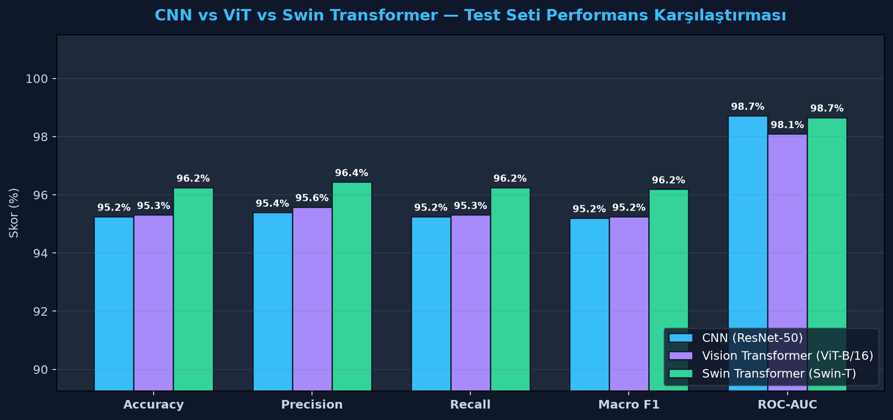
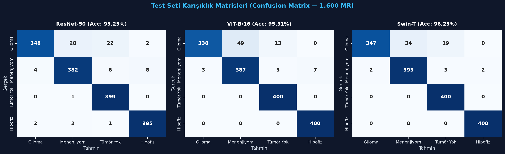
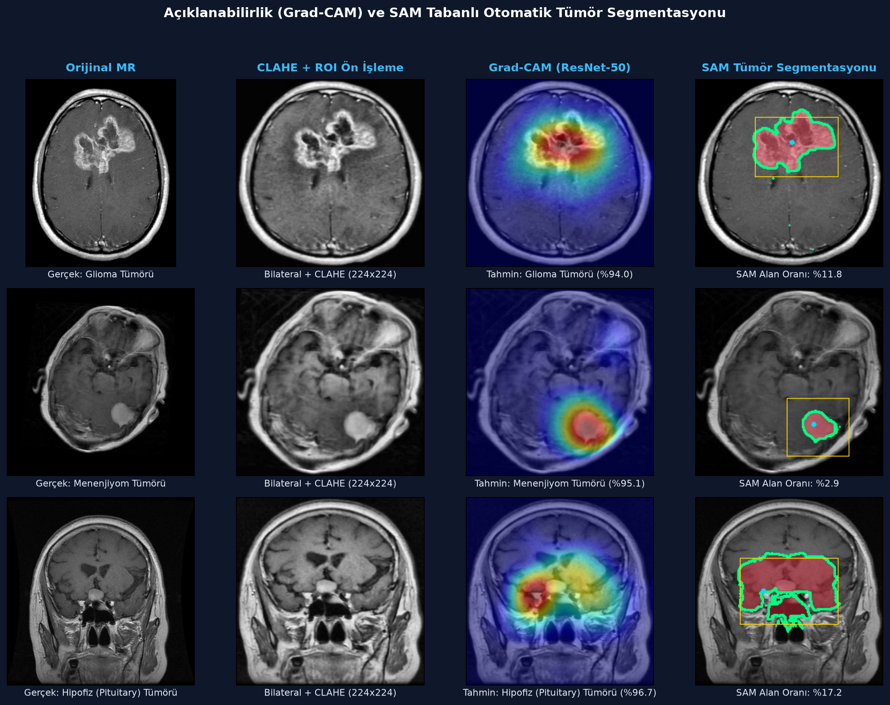

# 🧠 Medikal Görüntülerden Hastalık Tespiti

> **Görüntü İşleme Dersi Proje Ödevi** — Beyin MR Görüntülerinde Klasik Görüntü İşleme, CNN, ViT, Swin Transformer ve SAM Tabanlı Tümör Tespiti ve Segmentasyonu

## 📌 Proje Özeti
Bu proje, Beyin MR görüntülerinden **Glioma, Menenjiyom, Hipofiz Tümörü ve Sağlıklı (Tümör Yok)** sınıflarını tespit eden, kararını **Grad-CAM** ile görsel olarak açıklayan ve **SAM (MobileSAM)** kullanarak tümör bölgesini piksel hassasiyetinde segmente eden uçtan uca bir görüntü işleme ve derin öğrenme uygulamasıdır.

### Öne Çıkan Özellikler
- **Klasik Görüntü İşleme Ön İşleme Hattı (`src/preprocessing.py`):**
  - JPG/PNG ve **DICOM (`.dcm`)** okuma desteği
  - **Otsu Otomatik Eşikleme + Morfolojik Kapama/Açma + En Büyük Kontur** ile beyin ROI kırpma
  - Kenar koruyucu **Bilateral** (ve seçilebilir Gaussian/Median) gürültü filtresi
  - **CLAHE** (*Contrast Limited Adaptive Histogram Equalization*) ile yerel kontrast iyileştirme
- **Karşılaştırmalı Derin Öğrenme (`src/models.py`, `src/train.py`):**
  - **CNN:** `ResNet-50`
  - **Vision Transformer:** `ViT-B/16` (`vit_base_patch16_224`)
  - **Swin Transformer:** `Swin-T` (`swin_tiny_patch4_window7_224`)
  - Canlı arayüzde **3'lü Ensemble** seçeneği
- **Açıklanabilir Yapay Zeka & Segmentasyon (`src/explain_and_segment.py`):**
  - CNN, ViT ve Swin mimarilerinin tamamını destekleyen özel **Unified Grad-CAM**
  - Grad-CAM ısı haritasından otomatik kutu/nokta prompt çıkarımı ile **MobileSAM (Ultralytics)** tümör segmentasyonu ve alan oranı (%) hesabı
- **Canlı Demo Arayüzü (`app.py`):** 4 sekmeli etkileşimli **Streamlit** web uygulaması.

---

## 📊 Deneysel Sonuçlar (1.600 Bağımsız Test MR Görüntüsü)

Donanım: **NVIDIA GeForce RTX 5070 Ti**

| Model | Parametre | Accuracy | Precision | Recall | Macro F1 | ROC-AUC | Çıkarım Hızı |
| :--- | :---: | :---: | :---: | :---: | :---: | :---: | :---: |
| **CNN (ResNet-50)** | 23.5M | **95.25%** | 95.39% | 95.25% | **95.20%** | 98.72% | 12.26 ms |
| **Vision Transformer (ViT-B/16)** | 85.8M | **95.31%** | 95.58% | 95.31% | **95.25%** | 98.09% | 11.52 ms |
| **Swin Transformer (Swin-T)** | 27.5M | **96.25%** | 96.44% | 96.25% | **96.19%** | 98.66% | 11.45 ms |

### Görsel Çıktılar





---

## 🛠️ Kurulum ve Kullanım Kılavuzu

### 1. Repoyu Klonlayın
```bash
git clone https://github.com/berkay01akin/medeical_disase_dedect.git
cd medeical_disase_dedect
```

### 2. Bağımlılıkları Kurun
```bash
# NVIDIA GPU (RTX 50 serisi dahil CUDA 12.8) için PyTorch:
pip install torch torchvision --index-url https://download.pytorch.org/whl/cu128

# Diğer kütüphaneler:
pip install -r requirements.txt
```

### 3. Veri Setini Hazırlayın (Opsiyonel — Yeniden Eğitim İçin)
Kaggle *Brain Tumor MRI Dataset* (7.200 MR) ZIP dosyasını indirip ön-işleme hattından geçirin:
```bash
python scripts/prepare_dataset.py --zip-path "brain tumor.zip"
```

### 4. Modelleri Eğitin
```bash
python src/train.py --models cnn vit swin
```

### 5. Canlı Demo Arayüzünü Başlatın
```bash
streamlit run app.py
```

### 6. Rapor ve Sunum Dosyalarını Yeniden Üretin
```bash
python scripts/generate_deliverables.py
```

---

## 📁 Proje Klasör Yapısı
```text
├── app.py                              # 4 sekmeli Streamlit canlı demo arayüzü
├── project_config.json                 # Proje, ekip, repo ve hiperparametre yapılandırması
├── requirements.txt                    # Python bağımlılıkları
├── src/
│   ├── preprocessing.py                # Otsu, Morfoloji, ROI, Bilateral/Median/Gaussian, CLAHE, DICOM
│   ├── models.py                       # timm CNN (ResNet-50), ViT-B/16 ve Swin-T fabrikası
│   ├── explain_and_segment.py          # Unified Grad-CAM ve MobileSAM tümör segmentasyonu
│   └── train.py                        # Çoklu model eğitim, test ve grafik üretim betiği
├── scripts/
│   ├── prepare_dataset.py              # Veri seti çıkarma, stratified bölme ve ön-işleme
│   └── generate_deliverables.py        # Otomatik PDF rapor, PPTX sunum ve README üreticisi
├── sample_images/                      # Canlı demo için 12 adet örnek MR görüntüsü
├── results/
│   ├── metrics.json                    # Deneysel test metrikleri
│   └── plots/                          # Karşılaştırma, Confusion Matrix, ROC, Grad-CAM/SAM grafikleri
└── docs/
    ├── Proje_Raporu.pdf                # Ders kurallarına uygun proje raporu (kapakta GitHub linki)
    └── Sunum_Medikal_Goruntu_Tespiti.pptx  # 15 slaytlık 3 kişilik sunum dosyası
```

---

## 👥 Grup Üyeleri
| Ad Soyad | Öğrenci No | Sorumluluk Alanı |
| :--- | :---: | :--- |
| Berkay Akın | Öğrenci No | Veri Seti & Klasik Görüntü İşleme |
| 2. Grup Üyesi (Ad Soyad) | Öğrenci No | Derin Öğrenme Modelleri (CNN, ViT, Swin) & Değerlendirme |
| 3. Grup Üyesi (Ad Soyad) | Öğrenci No | Grad-CAM, SAM Segmentasyon & Streamlit Demo Arayüzü |

> ⚠️ **Yasal Uyarı:** Bu yazılım yalnızca akademik eğitim ve araştırma amaçlıdır; klinik tıbbi tanı aracı olarak kullanılamaz.
