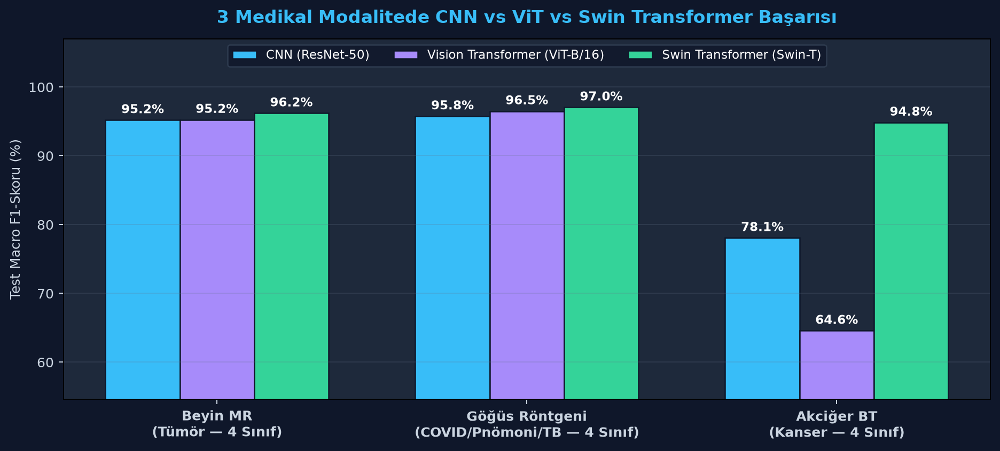
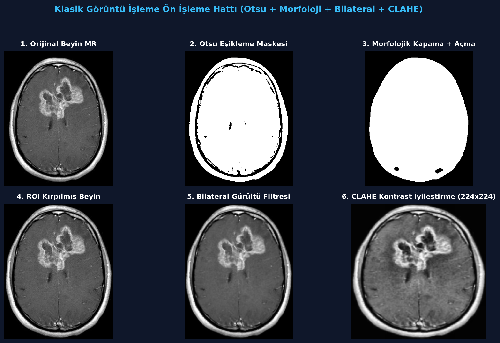

# 🏥 Medikal Görüntülerden Hastalık Tespiti (MR • Röntgen • Tomografi)

> **Görüntü İşleme Dersi Proje Ödevi** — MR, Röntgen ve Tomografi (BT) Görüntülerinde Otomatik Modalite Yönlendirmeli Klasik Görüntü İşleme, CNN, ViT, Swin Transformer ve SAM Tabanlı Hastalık Tespiti

## 📌 Proje Özeti
Bu proje; **Beyin MR (Tümör)**, **Göğüs Röntgeni (COVID-19, Pnömoni, Tüberküloz)** ve **Akciğer Tomografisi / BT (Akciğer Kanseri)** modalitelerinin tamamını tek bir çatı altında birleştiren, **Otomatik Modalite Router (`ResNet-18`)** ile yüklenen görüntüyü otomatik tanıyan ve yanlış modalite yüklemelerini engelleyen uçtan uca bir medikal görüntü işleme sistemidir.

### Öne Çıkan Özellikler
- **🤖 Otomatik Modalite Router (`ResNet-18`):** Yüklenen ham görüntünün MR, Röntgen veya BT olduğunu otomatik tespit eder ve ilgili uzman modellere yönlendirir; manuel seçimde uyuşmazlık varsa uyarı verir.
- **🧪 Modaliteye Duyarlı Klasik Görüntü İşleme (`src/preprocessing.py`):**
  - JPG/PNG ve **DICOM (`.dcm`)** okuma (`pydicom`)
  - **Otsu + Morfolojik Kapama/Açma ROI Kırpma** (MR & BT'de siyah kenar temizliği; Röntgende akciğer alanı korunur)
  - Kenar koruyucu **Bilateral** (ve seçilebilir Gaussian/Median) filtre + **CLAHE** kontrast iyileştirme
- **🧠 3 Modalite × 3 Derin Öğrenme Mimarisi (9 Uzman Model):** Her modalitede **CNN (`ResNet-50`)**, **ViT (`ViT-B/16`)**, **Swin Transformer (`Swin-T`)** ve **3'lü Ensemble**.
- **🔥 Açıklanabilirlik & Segmentasyon (`src/explain_and_segment.py`):** Özel **Unified Grad-CAM** + otomatik kutu/nokta promptlu **MobileSAM (Ultralytics)** lezyon segmentasyonu ve alan oranı (%) hesabı.

---

## 📊 Deneysel Sonuçlar

**Otomatik Modalite Router (ResNet-18):** 405 test görüntüsünde **100.00% Accuracy** / **100.00% Macro F1** (43.04 ms/img)

### 1. 3 Modalitede CNN vs ViT vs Swin Karşılaştırması
| Modalite | Model | Accuracy | Precision | Recall | Macro F1 | ROC-AUC | Hız |
| :--- | :--- | :---: | :---: | :---: | :---: | :---: | :---: |
| 🧠 **Beyin MR** | CNN (ResNet-50) | **95.25%** | 95.39% | 95.25% | **95.20%** | 98.72% | 12.26 ms |
| 🧠 **Beyin MR** | Vision Transformer (ViT-B/16) | **95.31%** | 95.58% | 95.31% | **95.25%** | 98.09% | 11.52 ms |
| 🧠 **Beyin MR** | Swin Transformer (Swin-T) | **96.25%** | 96.44% | 96.25% | **96.19%** | 98.66% | 11.45 ms |
| 🫁 **Göğüs Röntgeni** | CNN (ResNet-50) | **95.58%** | 95.64% | 96.11% | **95.75%** | 99.55% | 26.83 ms |
| 🫁 **Göğüs Röntgeni** | Vision Transformer (ViT-B/16) | **96.21%** | 96.59% | 96.54% | **96.49%** | 99.65% | 26.77 ms |
| 🫁 **Göğüs Röntgeni** | Swin Transformer (Swin-T) | **97.00%** | 96.80% | 97.36% | **97.05%** | 99.73% | 26.65 ms |
| 🩻 **Akciğer BT** | CNN (ResNet-50) | **76.83%** | 82.49% | 76.12% | **78.07%** | 94.66% | 55.01 ms |
| 🩻 **Akciğer BT** | Vision Transformer (ViT-B/16) | **66.35%** | 68.68% | 64.08% | **64.57%** | 86.15% | 53.73 ms |
| 🩻 **Akciğer BT** | Swin Transformer (Swin-T) | **94.60%** | 95.00% | 94.78% | **94.85%** | 99.66% | 52.27 ms |

### 2. Harici Klinik Doğrulama — BRISC 2025 (300 Bağımsız Beyin MR)
| Model / Yöntem | Harici Accuracy | Harici Macro F1 |
| :--- | :---: | :---: |
| **CNN (ResNet-50)** | **98.00%** | **98.15%** |
| **Vision Transformer (ViT-B/16)** | **98.33%** | **98.50%** |
| **Swin Transformer (Swin-T)** | **99.00%** | **99.00%** |
| **3'lü Ensemble (CNN + ViT + Swin)** | **99.00%** | **99.00%** |

### Görsel Çıktılar




---

## 🛠️ Kurulum ve Kullanım

```bash
git clone https://github.com/berkay01akin/medeical_disase_dedect.git
cd medeical_disase_dedect

# NVIDIA GPU (CUDA 12.8) için PyTorch ve bağımlılıklar
pip install torch torchvision --index-url https://download.pytorch.org/whl/cu128
pip install -r requirements.txt

# Canlı 3 Modaliteli Demo Arayüzünü başlatın
streamlit run app.py
```

> **Not:** Eğitilmiş model ağırlıkları (`.pth`) GitHub'ın 100 MB tek dosya sınırı nedeniyle `.gitignore` içindedir; repo üzerindeki **Releases** bölümünden indirip `checkpoints/` klasörüne yerleştirilebilir veya `python scripts/prepare_multimodal_datasets.py` + `python src/train_multimodal.py` ile yeniden eğitilebilir.

---

## 👥 Grup Üyeleri
| Ad Soyad | Öğrenci No | Sorumluluk Alanı |
| :--- | :---: | :--- |
| Berkay Akın | Öğrenci No | Veri Setleri, Klasik Görüntü İşleme & Modalite Router |
| 2. Grup Üyesi (Ad Soyad) | Öğrenci No | Çoklu Modalite Derin Öğrenme Modelleri (CNN, ViT, Swin) & Değerlendirme |
| 3. Grup Üyesi (Ad Soyad) | Öğrenci No | Grad-CAM, MobileSAM Segmentasyon & 3 Modaliteli Streamlit Arayüzü |

---

## 📚 Kaynakça
- [1] N. Otsu, 'A Threshold Selection Method from Gray-Level Histograms,' IEEE Trans. Systems, Man, and Cybernetics, vol. 9, no. 1, pp. 62–66, 1979.
- [2] K. Zuiderveld, 'Contrast Limited Adaptive Histogram Equalization,' Graphics Gems IV, Academic Press, pp. 474–485, 1994.
- [3] C. Tomasi and R. Manduchi, 'Bilateral Filtering for Gray and Color Images,' Proc. IEEE ICCV, pp. 839–846, 1998.
- [4] K. He, X. Zhang, S. Ren, and J. Sun, 'Deep Residual Learning for Image Recognition,' Proc. IEEE/CVF CVPR, pp. 770–778, 2016.
- [5] A. Dosovitskiy et al., 'An Image is Worth 16x16 Words: Transformers for Image Recognition at Scale,' ICLR, 2021.
- [6] Z. Liu et al., 'Swin Transformer: Hierarchical Vision Transformer using Shifted Windows,' Proc. IEEE/CVF ICCV, pp. 10012–10022, 2021.
- [7] R. R. Selvaraju et al., 'Grad-CAM: Visual Explanations from Deep Networks via Gradient-Based Localization,' Proc. IEEE ICCV, pp. 618–626, 2017.
- [8] A. Kirillov et al., 'Segment Anything,' Proc. IEEE/CVF ICCV, pp. 4015–4026, 2023.
- [9] C. Zhang et al., 'Faster Segment Anything: Towards Lightweight SAM for Mobile Applications (MobileSAM),' arXiv:2306.14289, 2023.
- [10] M. Nickparvar, 'Brain Tumor MRI Dataset (Figshare, SARTAJ, Br35H),' Kaggle Dataset, 2021.
- [11] ChehabLab, 'BRISC 2025: Brain Tumor MRI Classification & Segmentation Benchmark,' Hugging Face (chehablab/BRISC2025), 2025.
- [12] M. E. H. Chowdhury et al., 'COVID-19 Radiography & Pneumonia/Tuberculosis Chest X-Ray Benchmark,' IEEE Access / Hugging Face (fahmiaziz/pneumonia-covid-tuberculosis).
- [13] Chest CT-Scan Lung Cancer 4-Class Dataset (Adenocarcinoma, Large Cell, Squamous Cell, Normal), Hugging Face (Kabil007/LungCancer4Types), 2024.

> ⚠️ **Yasal Uyarı:** Bu yazılım yalnızca akademik eğitim ve araştırma amaçlıdır; klinik tıbbi tanı aracı olarak kullanılamaz.
