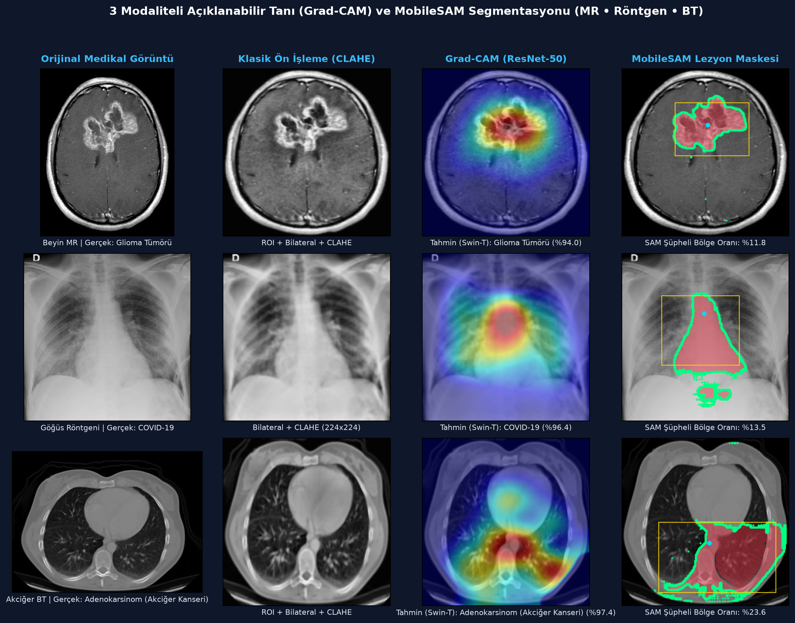

# 🏥 Medikal Görüntülerden Hastalık Tespiti (MR • Röntgen • Tomografi)

> **Görüntü İşleme Dersi Proje Ödevi** — MR, Röntgen ve Tomografi (BT) Görüntülerinde Otomatik Modalite Yönlendirmeli Klasik Görüntü İşleme, CNN, ViT, Swin Transformer ve SAM Tabanlı Hastalık Tespiti

## 📌 Proje Özeti
Bu proje; **Beyin MR (4 Sınıf Tümör — 7.200 MR)**, **Göğüs Röntgeni (COVID-19, Pnömoni, Tüberküloz, Normal — 3.174 Dengeli X-Ray)** ve **Akciğer Tomografisi / BT (4 Sınıf Kanser — 1.000 BT)** modalitelerinin tamamını tek platformda birleştiren, **Otomatik Modalite Router (`ResNet-18`)** destekli uçtan uca bir medikal görüntü işleme ve karar destek sistemidir.

### Temel Özellikler
- **🤖 Otomatik Modalite Router (`ResNet-18`):** Yüklenen görüntünün MR, Röntgen veya BT olduğunu %100 doğrulukla (405/405) tespit eder; yanlış modalite yüklemelerine karşı kullanıcıyı uyarır.
- **🧪 Modaliteye Duyarlı Klasik Görüntü İşleme (`src/preprocessing.py`):** Otsu eşikleme, morfolojik kapama/açma ROI kırpma *(MR & BT)*, Bilateral gürültü azaltma, CLAHE kontrast iyileştirme ve DICOM (`.dcm`) okuma.
- **🧠 3 Modalite × 3 Derin Öğrenme Mimarisi (9 Uzman Model):** CNN (`ResNet-50`), Vision Transformer (`ViT-B/16`), Swin Transformer (`Swin-T`) ve canlı **3'lü Ensemble**.
- **🔥 Açıklanabilirlik & Segmentasyon (`src/explain_and_segment.py`):** Özel **Unified Grad-CAM** + otomatik kutu ve negatif köşe promptlu **MobileSAM (Ultralytics)** lezyon segmentasyonu ve alan oranı (%) hesabı.

---

## 📊 Deneysel Sonuçlar

**Otomatik Modalite Router (ResNet-18):** 405 bağımsız test görüntüsünde **100.00% Accuracy** / **100.00% Macro F1** (0 hata)

### 1. 3 Modalitede CNN vs ViT vs Swin Karşılaştırması
| Modalite | Model | Accuracy | Precision | Recall | Macro F1 | ROC-AUC | Hız |
| :--- | :--- | :---: | :---: | :---: | :---: | :---: | :---: |
| 🧠 **Beyin MR** | CNN (ResNet-50) | **95.25%** | 95.39% | 95.25% | **95.20%** | 98.72% | 12.26 ms |
| 🧠 **Beyin MR** | Vision Transformer (ViT-B/16) | **95.31%** | 95.58% | 95.31% | **95.25%** | 98.09% | 11.52 ms |
| 🧠 **Beyin MR** | Swin Transformer (Swin-T) | **96.25%** | 96.44% | 96.25% | **96.19%** | 98.66% | 11.45 ms |
| 🫁 **Göğüs Röntgeni** | CNN (ResNet-50) | **95.58%** | 95.64% | 96.11% | **95.75%** | 99.55% | 26.83 ms |
| 🫁 **Göğüs Röntgeni** | Vision Transformer (ViT-B/16) | **96.21%** | 96.59% | 96.54% | **96.49%** | 99.65% | 26.77 ms |
| 🫁 **Göğüs Röntgeni** | Swin Transformer (Swin-T) | **97.00%** | 96.80% | 97.36% | **97.05%** | 99.73% | 26.65 ms |
| 🩻 **Akciğer BT** | CNN (ResNet-50) | **76.83%** | 82.49% | 76.12% | **78.07%** | 94.66% | 55.01 ms |
| 🩻 **Akciğer BT** | Vision Transformer (ViT-B/16) | **66.35%** | 68.68% | 64.08% | **64.57%** | 86.15% | 53.73 ms |
| 🩻 **Akciğer BT** | Swin Transformer (Swin-T) | **94.60%** | 95.00% | 94.78% | **94.85%** | 99.66% | 52.27 ms |

### 2. Harici Klinik Doğrulama — BRISC 2025 (300 Bağımsız Beyin MR)
| Model / Yöntem | Harici Accuracy | Harici Macro F1 |
| :--- | :---: | :---: |
| **CNN (ResNet-50)** | **98.00%** | **98.15%** |
| **Vision Transformer (ViT-B/16)** | **98.33%** | **98.50%** |
| **Swin Transformer (Swin-T)** | **99.00%** | **99.00%** |
| **3'lü Ensemble (CNN + ViT + Swin)** | **99.00%** | **99.00%** |

### Görsel Çıktılar




---

## 🛠️ Kurulum ve Kullanım

```bash
git clone https://github.com/berkay01akin/medeical_disase_dedect.git
cd medeical_disase_dedect

pip install torch torchvision --index-url https://download.pytorch.org/whl/cu128
pip install -r requirements.txt

# Eğitilmiş ağırlıklar için GitHub Releases (v2.0) içindeki 3 ZIP'i proje klasörüne çıkarın
streamlit run app.py
```

---

## 👥 Grup Üyeleri
| Ad Soyad | Öğrenci No | Sorumluluk Alanı |
| :--- | :---: | :--- |
| Berkay Akın | Öğrenci No | Veri Setleri, Klasik Görüntü İşleme & Modalite Router |
| 2. Grup Üyesi (Ad Soyad) | Öğrenci No | Çoklu Modalite Derin Öğrenme Modelleri (CNN, ViT, Swin) & Değerlendirme |
| 3. Grup Üyesi (Ad Soyad) | Öğrenci No | Grad-CAM, MobileSAM Segmentasyon & 3 Modaliteli Streamlit Arayüzü |

---

## 📚 Kaynakça (21 Referans)
- [1] N. Otsu, 'A Threshold Selection Method from Gray-Level Histograms,' IEEE Transactions on Systems, Man, and Cybernetics, vol. 9, no. 1, pp. 62–66, 1979.
- [2] K. Zuiderveld, 'Contrast Limited Adaptive Histogram Equalization (CLAHE),' Graphics Gems IV, Academic Press, pp. 474–485, 1994.
- [3] C. Tomasi and R. Manduchi, 'Bilateral Filtering for Gray and Color Images,' Proc. IEEE Int. Conf. on Computer Vision (ICCV), pp. 839–846, 1998.
- [4] R. C. Gonzalez and R. E. Woods, Digital Image Processing, 4th ed., Pearson Education, 2018 (Morfolojik Açma/Kapama, Histogram Eşitleme ve Ön İşleme Temelleri).
- [5] K. He, X. Zhang, S. Ren, and J. Sun, 'Deep Residual Learning for Image Recognition (ResNet),' Proc. IEEE/CVF CVPR, pp. 770–778, 2016.
- [6] A. Dosovitskiy et al., 'An Image is Worth 16x16 Words: Transformers for Image Recognition at Scale (ViT),' Int. Conf. on Learning Representations (ICLR), 2021.
- [7] Z. Liu et al., 'Swin Transformer: Hierarchical Vision Transformer using Shifted Windows,' Proc. IEEE/CVF ICCV, pp. 10012–10022, 2021.
- [8] R. R. Selvaraju et al., 'Grad-CAM: Visual Explanations from Deep Networks via Gradient-Based Localization,' Proc. IEEE ICCV, pp. 618–626, 2017.
- [9] A. Kirillov et al., 'Segment Anything (SAM),' Proc. IEEE/CVF ICCV, pp. 4015–4026, 2023.
- [10] C. Zhang et al., 'Faster Segment Anything: Towards Lightweight SAM for Mobile Applications (MobileSAM),' arXiv:2306.14289, 2023.
- [11] I. Loshchilov and F. Hutter, 'Decoupled Weight Decay Regularization (AdamW),' ICLR, 2019; ve 'SGDR: Stochastic Gradient Descent with Warm Restarts (Cosine Annealing),' ICLR, 2017.
- [12] A. Paszke et al., 'PyTorch: An Imperative Style, High-Performance Deep Learning Library,' Advances in Neural Information Processing Systems (NeurIPS), vol. 32, 2019.
- [13] G. Bradski, 'The OpenCV Library,' Dr. Dobb's Journal of Software Tools, 2000.
- [14] R. Wightman, 'PyTorch Image Models (timm),' GitHub Repository, 2019. [Çevrimiçi]: https://github.com/huggingface/pytorch-image-models
- [15] G. Jocher, A. Chaurasia, and J. Qiu, 'Ultralytics YOLO & SAM Framework,' GitHub Repository, 2023. [Çevrimiçi]: https://github.com/ultralytics/ultralytics
- [16] F. Pedregosa et al., 'Scikit-learn: Machine Learning in Python,' Journal of Machine Learning Research (JMLR), vol. 12, pp. 2825–2830, 2011.
- [17] D. Mason, 'SU-E-T-33: pydicom: An Open Source DICOM Library,' Medical Physics, vol. 38, no. 6, p. 3493, 2011; ve Streamlit Web Framework, https://streamlit.io.
- [18] M. Nickparvar, 'Brain Tumor MRI Dataset (Figshare, SARTAJ, Br35H),' Kaggle Dataset, 2021. [Çevrimiçi]: https://www.kaggle.com/datasets/masoudnickparvar/brain-tumor-mri-dataset
- [19] ChehabLab, 'BRISC 2025: Brain Tumor MRI Classification & Segmentation Benchmark,' Hugging Face Datasets (chehablab/BRISC2025), 2025.
- [20] M. E. H. Chowdhury et al., 'Can AI Help in Screening Viral and COVID-19 Pneumonia?,' IEEE Access, vol. 8, pp. 132665–132676, 2020 (Hugging Face: fahmiaziz/pneumonia-covid-tuberculosis).
- [21] Chest CT-Scan Lung Cancer 4-Class Dataset (Adenocarcinoma, Large Cell, Squamous Cell, Normal), Hugging Face Datasets (Kabil007/LungCancer4Types), 2024.

> ⚠️ **Yasal Uyarı:** Bu yazılım yalnızca akademik eğitim ve araştırma amaçlıdır; klinik tıbbi tanı aracı olarak kullanılamaz.
